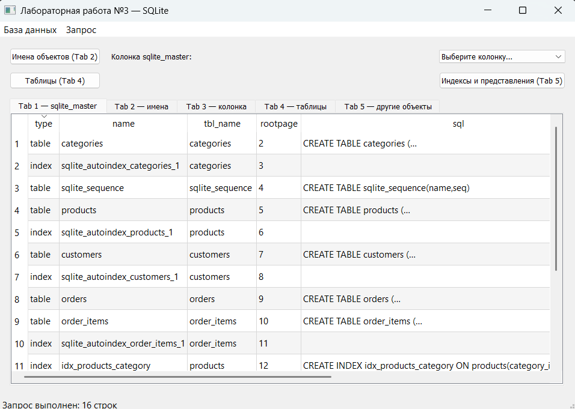
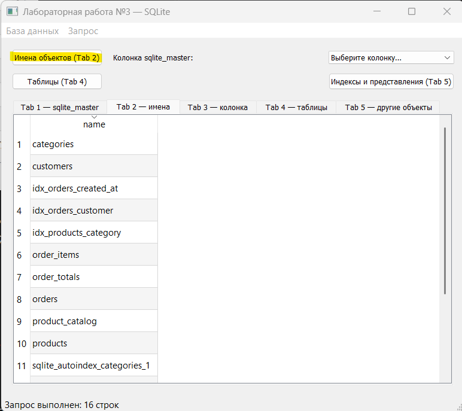
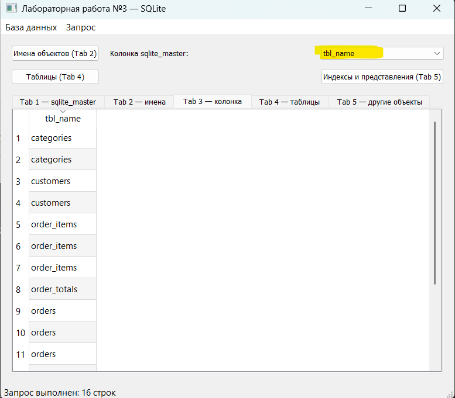
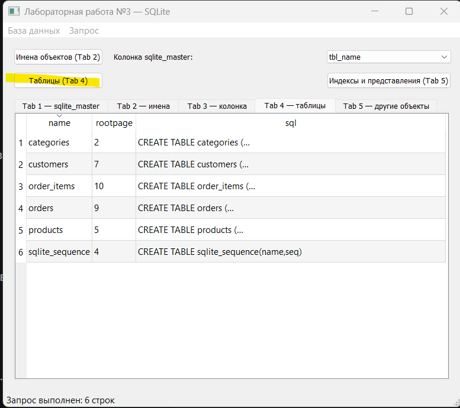
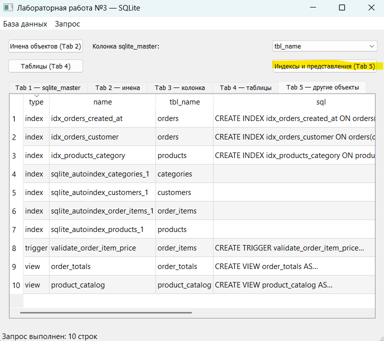
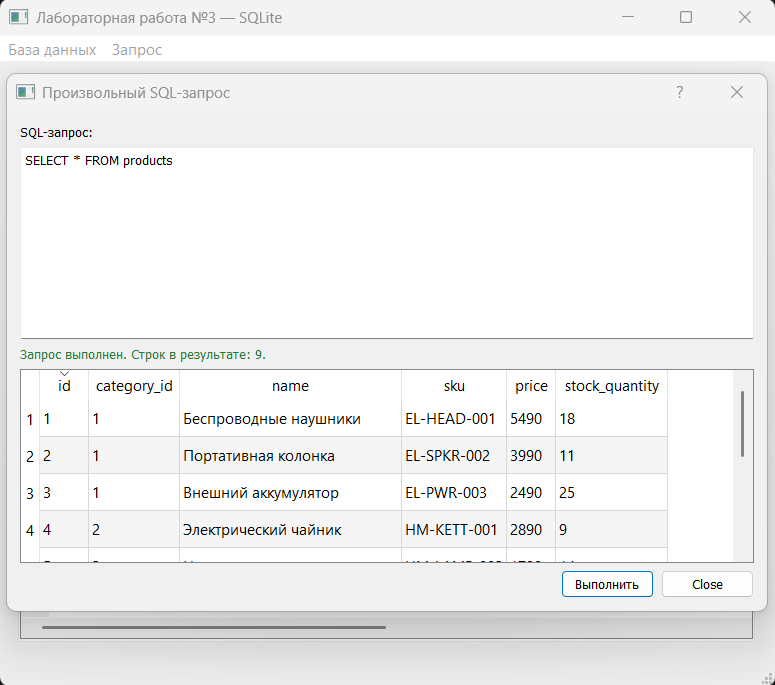

<!-- fullWidth: false tocVisible: false tableWrap: true -->
# Отчёт по лабораторной работе №3

**Выполнила:** Митрофанова М. С. <br>\
**Группа:** 6233-010402D <br>\
**Ссылка на исходный код:** https://github.com/maritolli/GUI/blob/main/lab3/main.py

## Тема и цель работы

Цель лабораторной работы - создать приложение на PyQt5, которое подключается к базе данных SQLite, выполняет SQL-запросы и показывает их результаты в табличном виде.

## Описание программы

В меню «База данных» находятся команды:

- **Set connection…** - выбор файла SQLite через QFileDialog и открытие соединения;
- **Close connection** - закрытие соединения и очистка всех результатов;
- **Выход** - завершение программы.

После успешного подключения на первой вкладке автоматически выполняется запрос:

```sql
SELECT * FROM sqlite_master
```

Результат выглядит на экране следующим образом:



Кнопка «Имена объектов» выполняет выборочный запрос `SELECT name FROM sqlite_master` и показывает результат на второй вкладке:



Выпадающий список позволяет выбрать одну из колонок системной таблицы sqlite_master; результат выводится на третьей вкладке:



Кнопки «Таблицы» и «Индексы и представления» выполняют запросы для разных типов объектов базы данных и выводят результаты на четвёртой и пятой вкладках. Каждый результат представлен с помощью `QTableView`, а данные предоставляет `QSqlQueryModel`:





Дополнительно в меню «Запрос» реализовано модальное окно «Выполнить SQL…». В нём можно ввести произвольный SQL-запрос и сразу увидеть его результат или сообщение об ошибке:



## Запуск

В папке лабораторной находится готовая демонстрационная база sample.db с данными магазина. После запуска необходимо выбрать пункт **База данных → Set connection…** и указать этот файл. Исходная структура базы и тестовые данные приведены в schema.sql.

## Результат

Приложение демонстрирует подключение к SQLite средствами Qt, выполнение SQL-запросов, работу сигналов и слотов, а также вывод данных через модель и табличное представление.