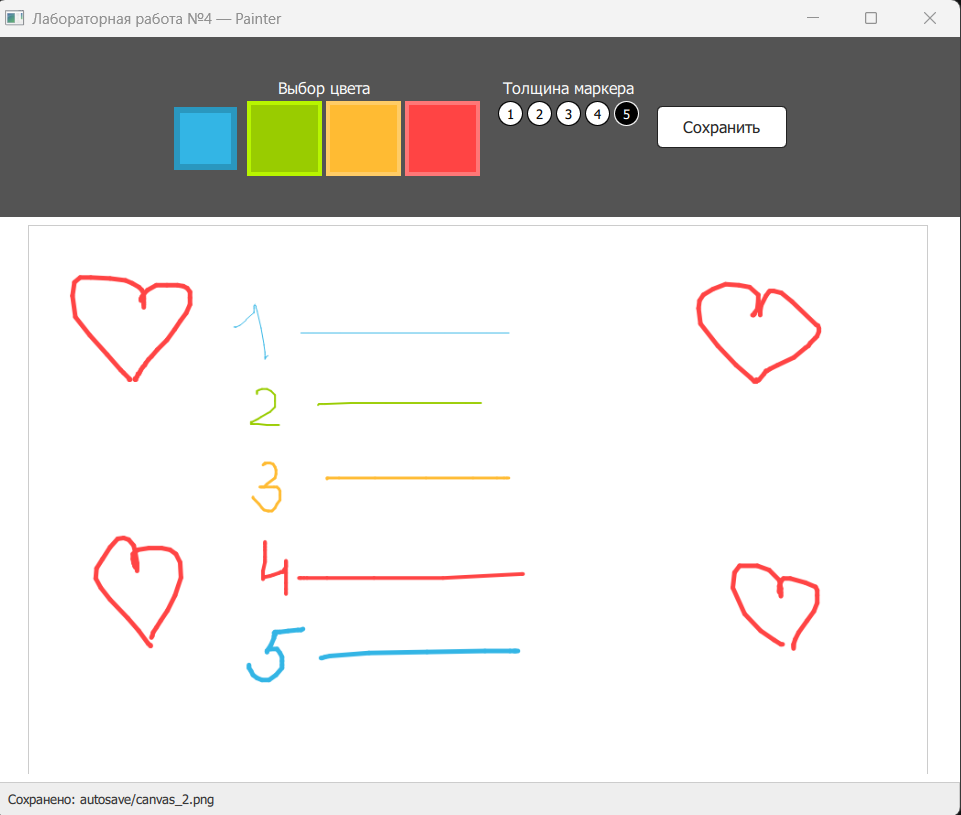
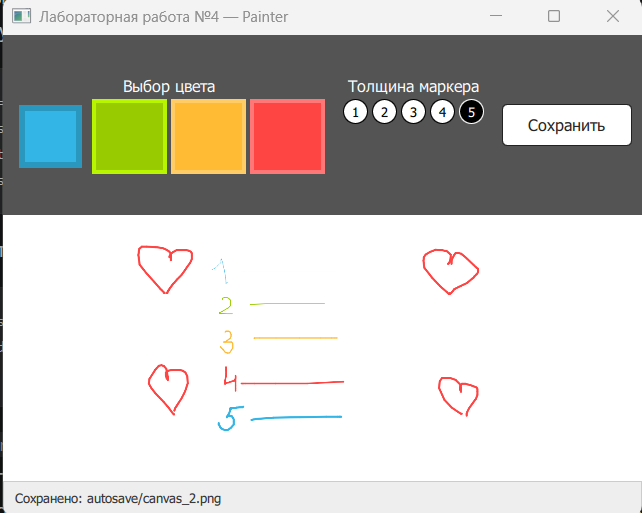

<!-- fullWidth: false tocVisible: false tableWrap: true -->
# Отчёт по лабораторной работе №4

**Выполнила:** Митрофанова М.С.

**Группа:** 6233-010402D

**Ссылка на исходный код:** __[https://github.com/maritolli/GUI/blob/main/lab4/main.py](https://github.com/maritolli/GUI/blob/main/lab4/main.py)__

## Тема и цель работы

Цель лабораторной работы - реализовать взаимодействие backend на PyQt5 и frontend на QML, а также автоматическое сохранение области рисования `Canvas` по таймеру.

## Описание программы

Приложение представляет собой простой графический редактор. Пользователь может выбрать один из четырёх цветов, установить толщину линии и рисовать мышью на холсте. Панель инструментов содержит подписи элементов и кнопку «Сохранить» для немедленного сохранения текущего изображения:



Класс `Interface` отвечает за автосохранение. После изменения холста он помечается как несохранённый. Таймер `QTimer` срабатывает каждые пять секунд и через сигнал `saveRequested` запрашивает у QML содержимое `Canvas` в формате PNG.

```python
self.timer = QTimer(self)
self.timer.setInterval(5_000)
self.timer.timeout.connect(self.request_save)
self.timer.start()
```

QML передаёт изображение backend в виде Data URL:

```qml
onSaveRequested: {
    _backend.saveCanvas(canvas.toDataURL("image/png"))
}
```

Метод `saveCanvas` декодирует данные и безопасно записывает их с помощью `QSaveFile` в подпапку `autosave`. История состоит из файлов `canvas_1.png` и `canvas_2.png`. После заполнения истории каждое следующее сохранение заменяет самый старый файл. Кнопка «Сохранить» выполняет эту операцию немедленно, независимо от таймера.

В нижней части окна показывается текущее состояние автосохранения. При закрытии приложения несохранённые изменения сохраняются, даже если таймер ещё не успел сработать. Холст имеет постоянный внутренний размер и масштабируется внутри доступной области, поэтому изменение размеров окна не очищает рисунок:



## Результат

Программа демонстрирует обмен сигналами между Python и QML, работу таймера и циклическое хранение двух последних версий изображения.